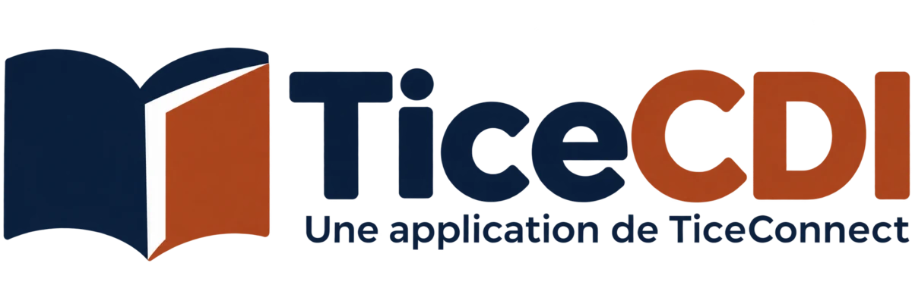

  
  <h1>TiceCDI</h1>
  
Présences, planning et fréquentation du CDI

  
Application gratuite à code source accessible.

  
<a href="#installation">Installation</a> · <a href="MANUEL.md">Manuel</a> · <a href="#sécurité">Sécurité</a> · <a href="CHANGELOG.md">Nouveautés</a> · <a href="#licence">Licence</a>

## Fonctions

| Espace | Fonctions principales |
| --- | --- |
| **Pointage** | Entrée ou sortie par carte CDI sur un poste activé par le personnel. Échéance calculée à l’heure pleine et prolongation par le CDI. |
| **Planning** | Horaires, réservations, fermetures, PDF et version HTML en tableau. Affichage sans connexion configurable, limité aux horaires et aux statuts. |
| **Gestion** | Annuaire et import minimal, fiches d’appel internes, présences, restrictions d’accès et dossiers individuels selon les habilitations. |
| **Fréquentation** | Tableau de bord avec graphiques (évolution, jours, heures, niveaux, classes, durées, types de venue) ; totaux et répartitions anonymes conservés après la purge. |
| **Administration** | Réglages de l’établissement, notices, fiche de registre, comptes nominatifs, purge et sauvegardes chiffrées. |
| **Sécurité** | Connexion par l’ENT (CAS ou OpenID Connect), double authentification (TOTP) facultative ou exigée, codes de secours, déconnexion après inactivité, sessions révocables, alertes d’échecs de connexion. |
| **Confort** | Thème sombre, borne installable, compatible douchettes QWERTY/AZERTY, places libres sur l’écran public, imports Pronote et SIECLE, rapport PDF de fréquentation. |

## Installation

| Édition | Télécharger | Guide |
| --- | --- | --- |
| PHP | [TiceCDI-PHP.zip](https://github.com/Xeros59/TiceCDI/releases/latest/download/TiceCDI-PHP.zip) | [PHP et XAMPP](docs/INSTALLATION-PHP.md) |
| Docker et Portainer | [Stack Portainer](compose.portainer.yaml) · [Image à importer](https://github.com/Xeros59/TiceCDI/releases/latest/download/TiceCDI-Docker-amd64.tar.gz) | [Docker et Portainer](docs/INSTALLATION-PORTAINER.md) |
| Docker depuis les sources | `docker compose up -d --build` après avoir copié `.env.example` en `.env` | [Variables et mise à jour](docs/INSTALLATION-PORTAINER.md) |

L’image Linux amd64 utilise l’adresse historique `ghcr.io/xeros59/gestion-cdi`. Les nouveautés de chaque version sont listées dans le [journal des versions](CHANGELOG.md). Une arrivée à **8 h 30** expire à **9 h**. Avec un créneau supplémentaire, elle expire à **10 h**. Une échéance expirée libère la place et reste distincte d’une sortie constatée.

## Avant le premier import

1. Installez TiceCDI sur une infrastructure autorisée par l’établissement, en HTTPS, avec un espace de données privé.
2. Ouvrez **Établissement et données personnelles** et renseignez l’identité, les contacts, la finalité, la base légale, la source d’import, les destinataires, l’hébergement, les droits et les durées retenues.
3. Vérifiez la notice élèves, la notice familles et la fiche de registre avec le DPD. Configurez les comptes du personnel, l’affichage éventuel du planning sans connexion et le poste dédié à la borne.
4. Testez la purge et la restauration avec des fiches fictives. Vérifiez l’heure du **dernier passage réussi** dans l’administration.

TiceCDI traite les données localement et ne contient ni télémétrie ni appel à un service tiers pour les données élèves. La mise à jour conserve les comptes et les données sur le volume existant. Les nouveaux déploiements proposent la fin de journée pour les passages nominatifs. Sur une base existante, la purge reste en attente de validation. Le [manuel](MANUEL.md) détaille la reprise et les durées.

## Sécurité

TiceCDI propose la double authentification par application (TOTP) avec codes de secours, une page de sessions actives et la trace des échecs de connexion dans le journal. Depuis la v1.3.0, la protection par défaut comprend aussi : mots de passe hachés en PBKDF2-SHA256 à 600 000 itérations (conversion automatique des anciens comptes), en-têtes de sécurité sur toutes les réponses, méthodes HTTP limitées, conteneur Docker en lecture seule sans privilèges et règles Apache et Nginx pour l’édition PHP.

Avant l’ouverture, suivez la [check-list de mise en production](SECURITY.md#check-list-de-mise-en-production) : HTTPS, `CDI_ORIGIN`, `CDI_TRUST_PROXY` derrière un proxy de confiance et accès à la gestion restreint au réseau de l’établissement. Les vulnérabilités se signalent selon [SECURITY.md](SECURITY.md).

## Licence

**© 2026 Thomas Luc**. TiceCDI est gratuit à code source accessible. L’usage personnel non commercial et l’usage interne non commercial par un établissement scolaire sont autorisés selon le [texte de licence](LICENSE). Les droits précédemment accordés sous MIT, les licences des composants tiers et les droits de consultation et de fork sur GitHub continuent de s’appliquer selon leurs propres conditions.
